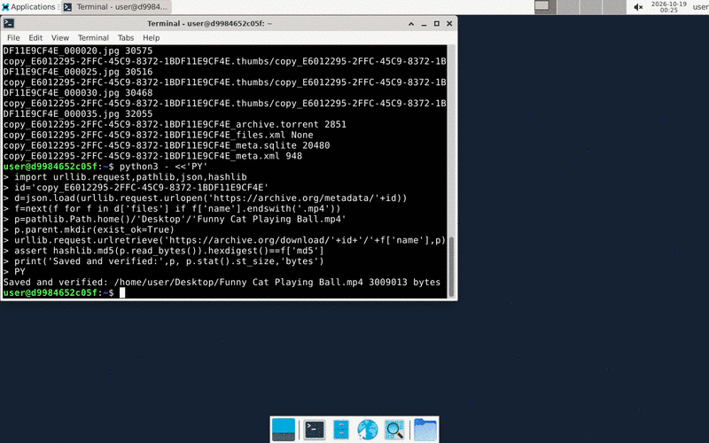

<div align="center">

# 🖥️ GPT Computer Use, in one file

**Give GPT a real Linux desktop and watch it work.**
Run the desktop locally with Docker, or in the cloud with [Orgo](https://orgo.ai) with nothing to install.

[OpenAI Computer Use docs](https://developers.openai.com/api/docs/guides/tools-computer-use) ·
[Orgo docs](https://docs.orgo.ai) ·
[GPT-6 Astra](https://developers.openai.com/api/docs/models/gpt-6-astra)



<sub><i>Real run: "find a picture of a real, funny cat and save it to the Desktop", 7 steps with <code>--fast</code></i></sub>

<sub>Prefer Claude? Same tutorial for Claude Opus 5.5: <a href="https://github.com/spencerkinney/opus-5-5-computer-use">opus-5-5-computer-use</a></sub>

</div>

---

## How it works

```
 ┌────────────┐   task + screenshot    ┌──────────────┐
 │   cua.py   │ ─────────────────────▶ │  OpenAI API  │
 │            │ ◀───────────────────── │ computer tool│
 └─────┬──────┘   click / type / ...   └──────────────┘
       │
       ▼  runs each action, takes a new screenshot, repeats
 ┌──────────────────────────────┐
 │  Linux desktop               │
 │  🐳 Docker (local)  or       │
 │  ☁️  Orgo (cloud)             │
 └──────────────────────────────┘
```

The model looks at a screenshot and replies with actions such as `click`, `type`, `scroll` or `keypress`. `cua.py` runs those actions on the desktop, sends back a fresh screenshot, and repeats until the task is done. Everything is in [one small file](cua.py).

### Three ways to run

| Mode | Command | Who runs the loop | Where the desktop runs | Keys needed |
| --- | --- | --- | --- | --- |
| 🐳 **Local** | `python cua.py "task"` | `cua.py` (your code) | Docker on your machine | OpenAI |
| ☁️ **Cloud** | `python cua.py "task" --orgo` | `cua.py` (your code) | Orgo cloud computer | OpenAI + Orgo |
| 🤖 **Orgo agent** | `python cua.py "task" --orgo-agent` | Orgo's hosted agent ([`orgo-agent`](https://docs.orgo.ai/api-reference/chat/completions), GPT-6 Astra) | Orgo cloud computer | Orgo only |

Use the first two modes to learn how computer use works and to customize the loop. Use `--orgo-agent` when you just want the task done. It's one API call, and Orgo handles screenshots, actions and retries. It's billed to your Orgo credits.

## Quick start

You need **Python 3.11+**.

**1. Install**

```bash
git clone https://github.com/spencerkinney/gpt-6-astra-computer-use.git && cd gpt-6-astra-computer-use
python3 -m venv .venv && source .venv/bin/activate
pip install -r requirements.txt
```

<details>
<summary>On Windows (PowerShell)</summary>

```powershell
git clone https://github.com/spencerkinney/gpt-6-astra-computer-use.git; cd gpt-6-astra-computer-use
py -3 -m venv .venv; .venv\Scripts\Activate.ps1
pip install -r requirements.txt
copy .env.example .env
```

Then use `python cua.py ...` exactly as below. Docker Desktop for Windows works for the local desktop.
</details>

**2. Get your API keys**

| Key | Where to get it | Needed for |
| --- | --- | --- |
| `OPENAI_API_KEY` | [platform.openai.com/api-keys](https://platform.openai.com/api-keys): click **Create new secret key**. It starts with `sk-`. | Local and `--orgo` |
| `ORGO_API_KEY` | Sign up at [orgo.ai/start](https://www.orgo.ai/start), then go to [Settings → Credentials](https://www.orgo.ai/settings/credentials). It starts with `sk_live_`. | `--orgo` and `--orgo-agent` |

Your OpenAI project needs access to a model that supports the [computer tool](https://developers.openai.com/api/docs/models/gpt-6-astra), plus billing set up. Each run costs a little, because every step sends a screenshot.

**3. Put the keys in `.env`**

```bash
cp .env.example .env
```

Open `.env` in any editor and paste your keys after the `=` signs:

```bash
OPENAI_API_KEY=sk-proj-abc123...
ORGO_API_KEY=sk_live_abc123...     # only for --orgo / --orgo-agent
```

`cua.py` loads `.env` automatically. `.env` is in `.gitignore`, so your keys are never committed. Exported shell variables (`export OPENAI_API_KEY=...`) also work.

**4. Pick where the desktop runs**

### Option A: 🐳 Local (Docker)

Needs [Docker Desktop](https://www.docker.com/products/docker-desktop/).

```bash
docker compose up -d --build                # builds and starts the desktop (first build takes ~2 min)
python cua.py "Open Firefox and search for the weather in Tokyo"
```

👀 **Watch it live:** [localhost:6080/vnc.html](http://localhost:6080/vnc.html?autoconnect=1&resize=scale)

Stop the desktop with `docker compose down`.

### Option B: ☁️ Cloud (Orgo), no Docker needed

Make sure `ORGO_API_KEY` is in your `.env` (see step 2). New Orgo accounts get free credit. To use it without a paid plan, also add `ORGO_BILLING_MODE=hourly` to `.env`. Then run:

```bash
python cua.py "Open a terminal and show me the system info" --orgo
```

The script boots a fresh cloud computer, prints a link to watch it live, and deletes the computer when the run ends. Add `--keep` to leave it running.

### Option C: 🤖 Orgo's hosted agent, no OpenAI key needed

Hand the whole loop to Orgo. The task runs on a fresh cloud computer, and the agent's progress streams into your terminal:

```bash
python cua.py "Open a terminal and show me the system info" --orgo-agent
```

## Usage

```bash
python cua.py                                   # runs a default demo task
python cua.py "your task here"                  # local Docker desktop
python cua.py "your task here" --orgo           # Orgo cloud computer, our loop
python cua.py "your task here" --orgo-agent     # Orgo cloud computer, Orgo's hosted loop
python cua.py "..." --fast                      # OpenAI Fast mode: up to 2.5x faster, billed at 2x
python cua.py "..." --orgo --name my-pc --keep  # name the Orgo computer and keep it afterwards
python cua.py "..." --model gpt-6.1-sol         # use any model that supports the computer tool
python cua.py "..." --max-steps 50              # allow longer tasks (default 30)
```

Every screenshot is saved to `runs/<timestamp>/` so you can replay what the model saw.

### Try these

```bash
python cua.py "Using only Firefox (no terminal), find a funny cat picture and save it to the Desktop" --fast
python cua.py "Open Firefox, go to news.ycombinator.com and tell me the top 3 stories"
python cua.py "Open a terminal, write a Python script that prints the first 10 primes, and run it"
python cua.py "Open the file manager and create a folder called hello-world on the desktop"
```

## What's inside

| File | What it is |
| --- | --- |
| [`cua.py`](cua.py) | The agent loop (`run`), two small backends (`Docker` uses `xdotool` via `docker exec`; `Orgo` uses the [REST API](https://docs.orgo.ai/api-reference/introduction)), and `run_orgo_agent` for Orgo's hosted loop |
| [`desktop/Dockerfile`](desktop/Dockerfile) | Debian + XFCE + Firefox + noVNC, based on [OpenAI's Docker recipe](https://developers.openai.com/api/docs/guides/tools-computer-use-integration#watch-and-control-a-local-desktop) |
| [`compose.yaml`](compose.yaml) | Starts the desktop. The viewer is published to `127.0.0.1` only. |

### Adding your own backend

A backend is any class with three methods:

```python
class MyComputer:
    watch_url = "https://..."
    def screenshot(self) -> bytes: ...   # PNG bytes
    def act(self, action): ...           # click, type, scroll, keypress, drag, move, wait
    def close(self): ...
```

### Inside the desktop image

**TL;DR:** computer use needs four things: a screen, a way to see it, a way to control it, and apps to use. Everything else is optional.

| Component | Job | Needed? |
| --- | --- | --- |
| `Xvfb` | A virtual screen in memory, so no monitor is needed | ✅ Core |
| `imagemagick` (`import`) | Takes the screenshots the model sees | ✅ Core |
| `xdotool` | Moves the mouse, clicks, types and presses keys | ✅ Core |
| `xfce4` + `dbus-x11` | A lightweight desktop: windows, a dock, a file manager | ✅ Core |
| `x11-utils` (`xdpyinfo`) | Checks the screen is ready before the desktop starts | ✅ Core |
| `firefox-esr` | Something to use | App |
| `x11vnc` + `novnc` + `websockify` | Lets *you* watch the desktop in your browser | Viewer only |

There isn't a separate "computer use server". `cua.py` runs each action with `docker exec cua-desktop xdotool ...` and grabs the screen with `docker exec cua-desktop import -window root png:-`.

<details>
<summary><b>OpenAI's original Docker recipe</b> (the starting point for <code>desktop/Dockerfile</code>)</summary>

From OpenAI's [integration recipes](https://developers.openai.com/api/docs/guides/tools-computer-use-integration#create-a-docker-image):

```dockerfile
FROM debian:bookworm-slim
ENV DEBIAN_FRONTEND=noninteractive
ENV DISPLAY=:99

RUN apt-get update && apt-get install -y --no-install-recommends \
    xfce4 \
    dbus-x11 \
    xvfb \
    xdotool \
    imagemagick \
    x11-utils \
    firefox-esr \
 && rm -rf /var/lib/apt/lists/* \
 && useradd --create-home --shell /bin/sh myuser

USER myuser
WORKDIR /home/myuser

CMD set -eu; \
    Xvfb :99 -screen 0 1280x800x24 -nolisten tcp & \
    display_pid=$!; \
    until xdpyinfo -display :99 >/dev/null 2>&1; do \
      kill -0 "$display_pid"; sleep 0.2; \
    done; \
    exec dbus-run-session -- startxfce4
```

```bash
docker build -t cua-image .
docker run --rm -d --name cua-image --network none \
  --cap-drop ALL --security-opt no-new-privileges \
  --pids-limit 256 --memory 2g --cpus 2 --shm-size 512m cua-image
docker exec cua-image import -window root png:- > desktop.png   # take a screenshot
```

**What [`desktop/Dockerfile`](desktop/Dockerfile) adds on top:**

- `x11vnc` + `novnc` + `websockify`, so you can watch at `localhost:6080`. OpenAI's [visual desktop variant](https://developers.openai.com/api/docs/guides/tools-computer-use-integration#watch-and-control-a-local-desktop) adds these too, as a separate viewer container.
- Internet access, so the agent can browse. The original runs with `--network none`.
- `LANG=C.UTF-8`, so `xdotool` can type accented letters and emoji. Without it, they fail.
- `xfce4-terminal` and emoji fonts.
- The dock's browser button opens Firefox directly, and Firefox's welcome tabs are turned off, so the model starts on a clean screen.

</details>

## Safety

Computer use acts on whatever is on the screen, so treat page content as untrusted.

- The desktop is **isolated**: it runs in a container or in a throwaway cloud computer, never on your own machine.
- Don't log the agent into accounts you care about, and don't put secrets on the screen.
- When OpenAI raises a **safety check** (for example, a suspected prompt injection), the script pauses and asks you before it continues.
- The local desktop can reach the internet so it can browse. For an offline desktop, use OpenAI's [internal-network compose file](https://developers.openai.com/api/docs/guides/tools-computer-use-integration#watch-and-control-a-local-desktop).

Read OpenAI's [Run safely](https://developers.openai.com/api/docs/guides/tools-computer-use#run-safely) guidance before you point this at anything real.

## Troubleshooting

| Message | Fix |
| --- | --- |
| `Missing OPENAI_API_KEY` | You skipped step 3. Create `.env` from `.env.example` and add your key. |
| `Desktop not running` | Start Docker Desktop, then run `docker compose up -d --build`. |
| `401` / `Incorrect API key` | The key is wrong or was revoked. Create a new one. |
| `model_not_found` / no access | Your project can't use that model. Try `--model gpt-6.1-sol`, or check [your project's model access](https://platform.openai.com/settings). |
| `Orgo API error` about plan, billing or capacity on `--orgo` | Probably no paid Orgo plan. Add `ORGO_BILLING_MODE=hourly` to `.env` to run on your free credit. |
| Viewer shows "Disconnected" | Reload the viewer tab. noVNC drops its connection when the container restarts. |
| Clicks land in the wrong place | Don't resize the desktop. Screenshots are sent at full size so the model's coordinates match the screen. |

## Using Claude Code or another coding agent?

Point it at [`AGENTS.md`](AGENTS.md). That file has the exact setup commands, where the keys go, and how to verify a run. Claude Code picks it up automatically through `CLAUDE.md`.

## Resources

**OpenAI**
- [Computer use guide](https://developers.openai.com/api/docs/guides/tools-computer-use): overview, the computer tool, the SDK helpers
- [Integration recipes](https://developers.openai.com/api/docs/guides/tools-computer-use-integration): Docker setup, action handlers, screenshots
- [SDK drivers reference](https://developers.openai.com/api/docs/guides/tools-computer-use-sdk-drivers)
- [GPT-6 Astra model page](https://developers.openai.com/api/docs/models/gpt-6-astra)
- [CUA sample app](https://github.com/openai/openai-cua-sample-app): OpenAI's full reference app
- [API keys](https://platform.openai.com/api-keys) · [Pricing](https://developers.openai.com/api/docs/pricing)

**Orgo**
- [Orgo docs](https://docs.orgo.ai) · [Quickstart](https://docs.orgo.ai/quickstart)
- [OpenAI Computer Use on Orgo](https://docs.orgo.ai/guides/openai-computer-use)
- [Orgo hosted agent (chat completions)](https://docs.orgo.ai/api-reference/chat/completions)
- [API reference](https://docs.orgo.ai/api-reference/introduction)
- [Get an API key](https://www.orgo.ai/start) · [Pricing](https://orgo.ai/pricing)

## License

[MIT](LICENSE)
